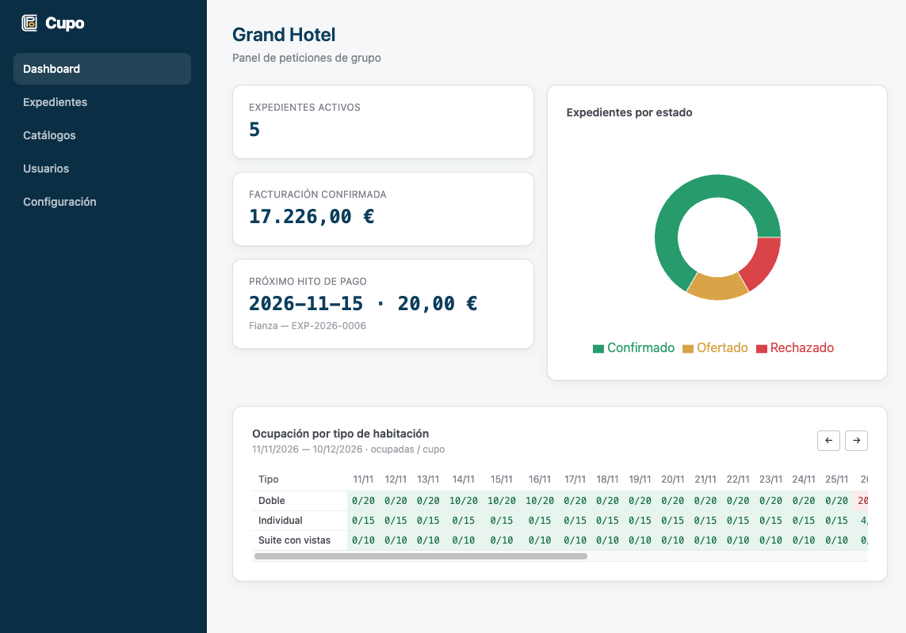
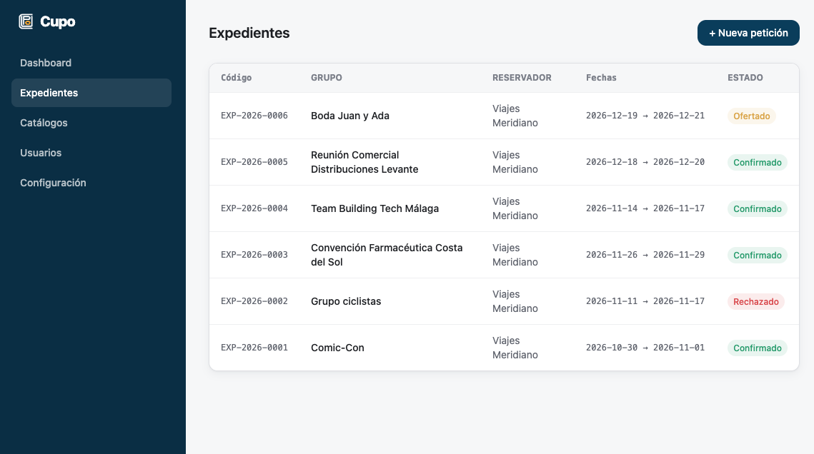
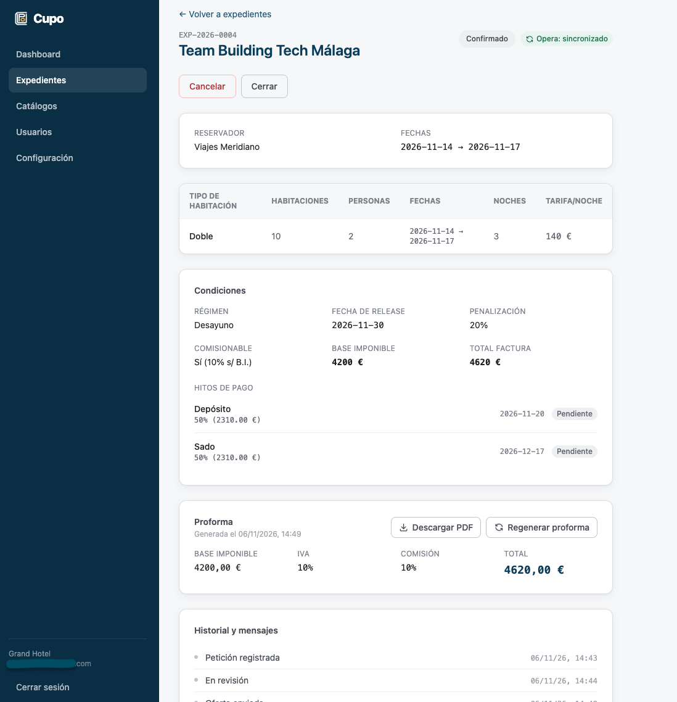
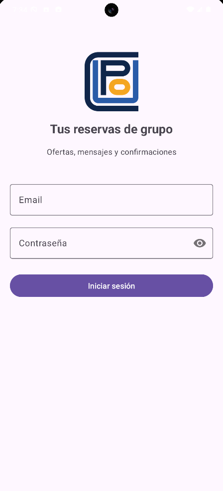
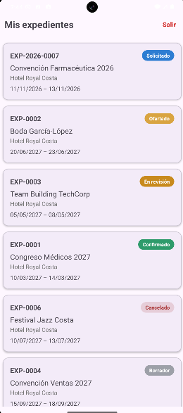

<div align="center">

# Víctor Rando Bustos

### Hotel Operations · Travel Tech · Customer Success

*Más de 20 años en operaciones de diversas empresas del sector servicios. Ahora también escribo código para ellas.*

</div>

---

## 👨‍💻 Sobre mí

Profesional con más de 20 años de experiencia en **gestión operativa, coordinación de equipos y dirección de actividades** en empresas del sector turístico y de servicios. Mi trayectoria abarca la dirección y coordinación de equipos multidisciplinares en empresas del sector servicios y ocio, la gestión operativa en entornos hoteleros internacionales, y el control presupuestario y supervisión de la experiencia de cliente — siempre con foco en resultados, procesos y personas.

El **Máster en Creación y Dirección de Empresas** (IMFE-ESESA) me proporcionó una base sólida en gestión estratégica, análisis de negocio, planificación y toma de decisiones que ha guiado mi forma de abordar cada proyecto desde entonces.

En 2023 añadí a ese perfil el **Ciclo Superior de Desarrollo de Aplicaciones Multiplataforma (DAM)**, convencido de que entender la tecnología desde dentro es hoy imprescindible para quien quiere liderar procesos de transformación digital, implementar sistemas de gestión o conectar el negocio con las soluciones que lo hacen más eficiente.

Busco oportunidades en **consultoría, gestión de proyectos tecnológicos, operaciones o customer success** — en empresas del sector turístico, Travel Tech, software de gestión o cualquier entorno donde la combinación de visión de negocio y capacidad técnica marque la diferencia.

- 🏢 **+20 años** en gestión operativa, coordinación y dirección · Sector turístico
- 🎓 **Máster** en Creación y Dirección de Empresas · IMFE-ESESA · 2006
- 💻 **DAM** en curso · IES Portada Alta · Desde 2023
- 🎓 **Diplomatura en Turismo** · Universidad de Málaga · 1999–2002
- 📍 Málaga, Andalucía
- 🌍 **ES** Nativo · **EN** B2/C1 · **FR** e **IT** Básico

---

## 🎯 Áreas de interés

```
🏨 Software Hotelero & Travel Tech       🔄 Transformación Digital
📊 ERP y Sistemas de Gestión (Odoo)      🤝 Customer Success
🔍 Consultoría Tecnológica               ⚙️  Operaciones y Soporte Funcional
```

---

## 🚀 Proyectos destacados

| Proyecto | Descripción | Stack |
|---|---|---|
| [**Cupo**](https://cupo.vrando.me/) | Plataforma B2B de reservas de grupo para hoteles: expedientes con tarifas, condiciones, hitos de pago y proforma PDF, panel de ocupación por tipo de habitación y sincronización con Opera Cloud (simulada con WireMock). Incluye cliente Android para el reservador. Desplegado en mi servidor, con acceso por usuario; el código es privado. Nace de mi trabajo diario con Opera en recepción. | Java 21 · Spring Boot · PostgreSQL · React · Vite · Tailwind · Kotlin |
| [**Hotel Quotation Generator**](https://vrando.me/hotel/presupuesto.html) | Generador de presupuestos de alojamiento hotelero con cálculo de IVA, comisión agencia, proforma PDF y exportación Excel. Desplegado en producción. Nació de una necesidad real del trabajo diario. | HTML · CSS · JS · SheetJS |
| [**EverArt Patrimonio**](https://everartpatrimonio.com/) | Portfolio web profesional para una restauradora de arte. Galería coverflow filtrable, slideshow automático, menú responsive y formulario de contacto con FormSubmit. Sitio en producción. | HTML · CSS · JS |
| [**PMDM Room 3**](https://github.com/vrandob/PMDM_Room3) | App Android con doble persistencia: reservas de paseos a caballo con Room (offline) y gestor de herramientas IA con Firebase (nube). Arquitectura MVVM + Navigation Component. | Kotlin · Room · Firebase · MVVM |
| [**HLC5 MedicionFincas**](https://github.com/vrandob/HLC5_MedicionFincas) | App Android para medir fincas trazando polígonos sobre Google Maps. Calcula área (m²) y perímetro (m) de la superficie delimitada en tiempo real. | Kotlin · Google Maps API |
| [**AD03 Gestión Docente**](https://github.com/vrandob/AD03-GestionDocente-jpa-hibernate-mariadb-crud) | Sistema CRUD de gestión docente con JPA/Hibernate, mapeo de claves compuestas y automatización por ficheros de entrada. | Java · JPA · Hibernate · MariaDB |
| [**PHP CRUD Books**](https://github.com/vrandob/PHP-CRUD-MySQL-books-db) | Aplicación web CRUD completa para gestión de catálogo de libros, con interfaz en navegador. | PHP · MySQL · HTML |

<details>
<summary><b>Capturas de Cupo</b> (la aplicación requiere usuario y el repositorio es privado)</summary>

<br>

**Web · panel del hotel**







**Android · cliente del reservador**


&nbsp;&nbsp;


</details>

---

## 🛠️ Tecnologías

**Mobile & Backend**


**Datos**


**Web & Herramientas**


**Dominio profesional**


---

## 📬 Contacto

<div align="center">

[](https://github.com/vrandob)
[](https://linkedin.com/in/vrandob)
[](mailto:victorrandob@gmail.com)

</div>

---

<div align="center">
<sub>20 años entendiendo cómo funciona una empresa. Ahora también cómo programar para ella</sub>
</div>
